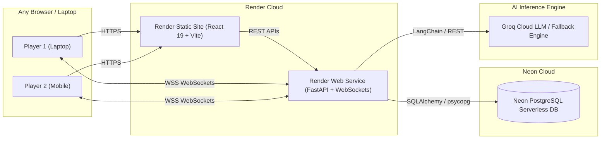

# ⚔️ Mythos: Premium Adventure Gaming Platform - Deployment Guide

This guide walks you through deploying the complete **Mythos** interactive storytelling & multiplayer gaming platform to **Render** and connecting it to **Neon PostgreSQL** so that anyone on any laptop or phone in the world can play, create stories, and participate in multiplayer rooms together.

---

## 🏗️ Architecture Overview



---

## 🌟 Prerequisites

1. **GitHub Account**: Push this repository (`game_project`) to GitHub.
2. **Neon Account**: Cloud PostgreSQL database.
   - Database connection string format:
     `postgresql://<USER>:<PASSWORD>@<HOST>/<DBNAME>?sslmode=require`
   - All 13 relational tables and migrations are pre-configured.
3. **Render Account**: Free account at [render.com](https://render.com).
4. **Groq API Key (Optional)**: Free API key at [console.groq.com](https://console.groq.com). (If omitted, the platform automatically activates its intelligent procedural story generator without interruption).

---

## 🚀 Option A: 1-Click Render Blueprint Deployment (Recommended)

This project contains a pre-configured `render.yaml` blueprint file at the root.

1. Push your repository to **GitHub**:
   ```bash
   git add .
   git commit -m "Transform Choose Your Own Adventure into Mythos Multiplayer Platform"
   git push origin main
   ```
2. Log in to [dashboard.render.com](https://dashboard.render.com).
3. Click **New +** $\rightarrow$ **Blueprint**.
4. Connect your GitHub repository.
5. Render will automatically detect `render.yaml` and configure:
   - **`mythos-backend`** (Python Web Service)
   - **`mythos-frontend`** (Static Site)
6. Under environment variable prompts for `mythos-backend`:
   - `DATABASE_URL`: Paste your Neon PostgreSQL connection string:
     `postgresql://<USER>:<PASSWORD>@<HOST>/<DBNAME>?sslmode=require`
   - `GROQ_API_KEY`: Paste your Groq API key (or leave empty).
7. Click **Apply**.
8. Render will build both services automatically!

---

## 🛠️ Option B: Manual Render Deployment

### Step 1: Deploy Backend Web Service
1. In Render Dashboard, click **New +** $\rightarrow$ **Web Service**.
2. Select your repository.
3. Fill in the details:
   - **Name**: `mythos-backend`
   - **Region**: `Ohio (US East)` (matches your Neon database region `us-east-2` for minimal latency)
   - **Branch**: `main`
   - **Root Directory**: Leave blank (uses repo root)
   - **Runtime**: `Python`
   - **Build Command**: `pip install -r backend/requirements.txt`
   - **Start Command**: `uvicorn backend.main:app --host 0.0.0.0 --port $PORT`
   - **Health Check Path**: `/health`
4. Add the following **Environment Variables**:
   | Variable | Value |
   | :--- | :--- |
   | `DATABASE_URL` | `postgresql://<USER>:<PASSWORD>@<HOST>/<DBNAME>?sslmode=require` |
   | `GROQ_API_KEY` | Your Groq API key |
   | `JWT_SECRET_KEY` | Any random 32-character secret string |
   | `API_PREFIX` | `/api` |
   | `Allowed_origins` | `*` |
   | `DEBUG` | `false` |
5. Click **Create Web Service**.
6. Note the public URL provided by Render, e.g. `https://mythos-backend.onrender.com`.

### Step 2: Deploy Frontend Static Site
1. In Render Dashboard, click **New +** $\rightarrow$ **Static Site**.
2. Select your repository.
3. Fill in the details:
   - **Name**: `mythos-frontend`
   - **Branch**: `main`
   - **Root Directory**: `frontend`
   - **Build Command**: `npm install && npm run build`
   - **Publish Directory**: `dist`
4. Add the following **Rewrite Rule** (for React SPA routing):
   - **Type**: `Rewrite`
   - **Source**: `/*`
   - **Destination**: `/index.html`
5. Add the following **Environment Variables**:
   | Variable | Value |
   | :--- | :--- |
   | `VITE_API_BASE_URL` | `https://mythos-backend.onrender.com/api` |
   | `VITE_WS_BASE_URL` | `wss://mythos-backend.onrender.com/ws` |
6. Click **Create Static Site**.
7. Your game is live!

---

## 💻 Running Locally (For Local Development)

### 1. Backend Setup:
```powershell
cd backend
python -m venv .venv
.\.venv\Scripts\activate
pip install -r requirements.txt
uvicorn backend.main:app --reload --port 8000
```
- Interactive Swagger docs will be available at: `http://localhost:8000/docs`
- Health check: `http://localhost:8000/health`

### 2. Frontend Setup:
```powershell
cd frontend
npm install
npm run dev
```
- Open `http://localhost:5173` in your browser.

---

## 🔒 Security & Anti-Cheat Features Included

1. **Centralized Authentication**: Signed HS256 JWT tokens with automatic profile hydration.
2. **Server-Side Reward Verification**: Coins and XP are awarded exclusively via server routes with anti-overdraft checks and duplicate achievement claim locks.
3. **Sliding-Window Rate Limiting**: In-memory rate limiting middleware prevents DDoS attacks and brute force logins.
4. **Hardened HTTP Headers**:
   - `X-Content-Type-Options: nosniff`
   - `X-Frame-Options: DENY`
   - `X-XSS-Protection: 1; mode=block`
   - `Referrer-Policy: strict-origin-when-cross-origin`
5. **Stateful Multiplayer Synchronization**: Fast WebSockets with server-side room management and auto-reconnection.
